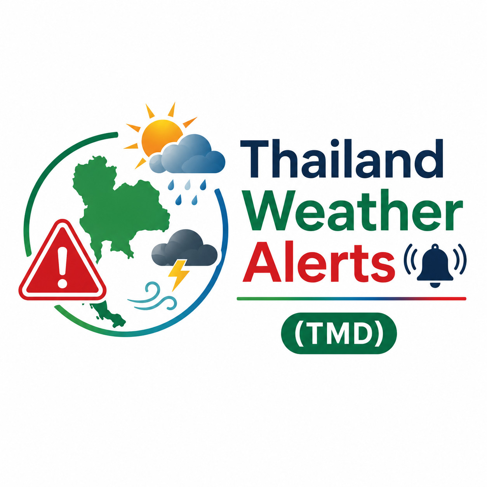
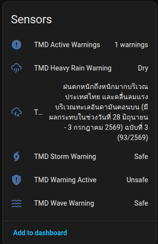
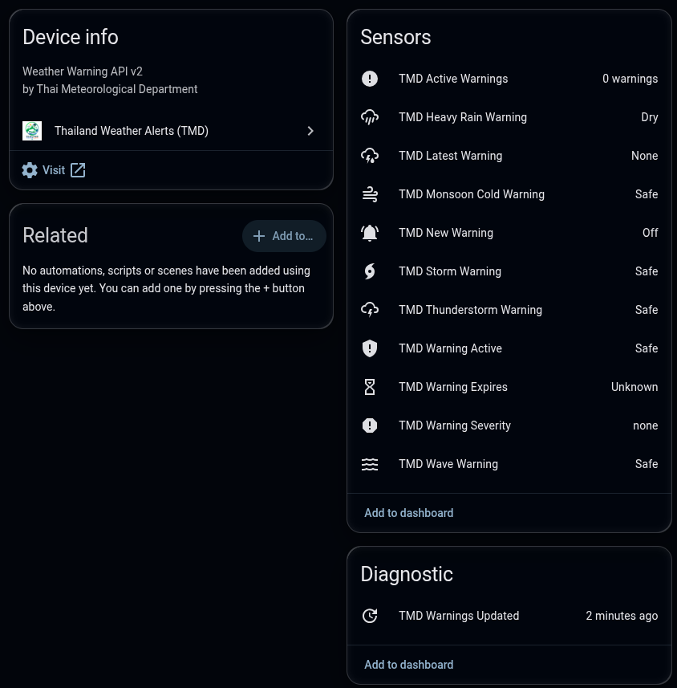

<p align="center">
  <a name="logo" href="http://nightdestiny.com">
    
  </a>
</p>

# Thailand Weather Alerts (TMD) <br> Integration for Home Assistant

A custom Home Assistant integration that fetches real-time weather warnings from the **[Thailand Meteorological Department (TMD)](https://tmd.go.th)** Weather Warning API and exposes them as entities inside Home Assistant.

> **Unofficial integration.** Not affiliated with or endorsed by the Thai Meteorological Department. During severe weather, always follow official government announcements.

---

## Features

- **Active warning count** and **latest warning** sensors (title, full text, dates, PDF link, hours remaining)
- **Warning expires** timestamp sensor — trigger an "all clear" automation when the last warning ends
- **Warning severity** sensor — `none` / `advisory` / `warning` / `severe`
- **Hazard binary sensors** — any warning, storm, heavy rain, wave, thunderstorm, monsoon/cold
- **New warning binary sensor** — pulses `ON` for 10 minutes when a previously unseen warning appears, so you are not re-notified on updates
- **Last updated** diagnostic sensor — time of the last successful fetch
- Expired warnings are ignored automatically
- Keyword matching in **English and Thai**, with word boundaries (a thunderstorm does not trigger the storm sensor; a heat wave does not trigger the wave sensor)
- **Language** option: auto-detect from Home Assistant, English, or Thai
- All entities grouped into a single **TMD device** in the device registry
- Automatic refresh every **10 minutes**
- Uses the official TMD REST API — no web scraping

---

## Requirements

- Home Assistant 2023.1 or newer
- Internet access to reach `data.tmd.go.th`
- No additional Python packages required (uses HA's built-in `aiohttp`)

---

## Installation

### HACS (recommended)

1. Open HACS → **Integrations** → three-dot menu → **Custom repositories**
2. Add `https://github.com/simplemice/tmd_alerts` with category **Integration**
3. Search for **Thailand Weather Alerts** and install
4. Restart Home Assistant

### Manual

1. Copy the `tmd_alerts` folder into your `config/custom_components/` directory:
   ```
   config/
   └── custom_components/
       └── tmd_alerts/
           ├── __init__.py
           ├── api.py
           ├── binary_sensor.py
           ├── brand/
           ├── classify.py
           ├── config_flow.py
           ├── const.py
           ├── coordinator.py
           ├── manifest.json
           ├── sensor.py
           ├── strings.json
           └── translations/
               └── en.json
   ```
2. Restart Home Assistant

---

## Configuration

1. Go to **Settings → Devices & Services → Add Integration**
2. Search for **Thailand Weather Alerts (TMD)**
3. In the setup form:
   - **API User ID** — leave as `demo` to use the public account
   - **API Key** — leave as `demokey` to use the public account
4. Choose a **Language** (`auto` follows your Home Assistant language, or force English / Thai)
5. Click **Submit**

The integration validates the credentials against the live API before saving. The language can be changed later via **Configure** on the integration card.

### Using your own API key

The demo account is shared and subject to TMD rate limits. For personal or production use, register for a free API key at:

```
http://data.tmd.go.th/api/index1.php
```

After registration enter your `uid` and `ukey` in the config form.

---

## Entities

All entities belong to the **Thailand Weather Alerts (TMD)** device.

### Sensors

| Entity ID | Name | State | Notes |
|-----------|------|-------|-------|
| `sensor.tmd_active_warnings` | TMD Active Warnings | Number of active (unexpired) warnings | Unit: `warnings` |
| `sensor.tmd_latest_warning` | TMD Latest Warning | Title of the most recently announced active warning (in the selected language) | See attributes below |
| `sensor.tmd_warning_expires` | TMD Warning Expires | Soonest `effect_end` among active warnings | `timestamp`; use as an "all clear" trigger |
| `sensor.tmd_warning_severity` | TMD Warning Severity | `none` / `advisory` / `warning` / `severe` | Keyword-derived: `severe` for very heavy rain, typhoon, cyclone, flash flood; `warning` for a recognised hazard; `advisory` otherwise |
| `sensor.tmd_warnings_updated` | TMD Warnings Updated | Time of last successful fetch | Diagnostic, `timestamp` |

#### `sensor.tmd_latest_warning` attributes

| Attribute | Description |
|-----------|-------------|
| `headline` | One-sentence summary of the warning |
| `description` | Full warning text |
| `effect_start` | Date/time the warning takes effect |
| `effect_end` | Date/time the warning expires |
| `announce_date` | Date/time the warning was issued |
| `url` | Link to the official PDF advisory |
| `contact` | TMD contact information |
| `issue_no` | TMD issue number |
| `hours_remaining` | Hours until the warning expires (empty if the end date is unknown) |
| `language` | Language used for the text attributes |

#### `sensor.tmd_active_warnings` attributes

| Attribute | Description |
|-----------|-------------|
| `warnings` | List of all active warnings (each with title, headline, effect start and end) |

### Binary Sensors

| Entity ID | Name | Device Class | Turns ON when |
|-----------|------|--------------|---------------|
| `binary_sensor.tmd_warning_active` | TMD Warning Active | `safety` | Any warning is active |
| `binary_sensor.tmd_storm_warning` | TMD Storm Warning | `safety` | Title/headline contains: *storm, tropical, typhoon, cyclone, depression* (thunderstorms excluded) |
| `binary_sensor.tmd_heavy_rain_warning` | TMD Heavy Rain Warning | `moisture` | Title/headline contains: *heavy rain, heavy to very heavy, flood, flash flood* |
| `binary_sensor.tmd_wave_warning` | TMD Wave Warning | `safety` | Title/headline contains: *wave, wind-wave, rough/high seas* (heat waves excluded) |
| `binary_sensor.tmd_thunderstorm_warning` | TMD Thunderstorm Warning | `safety` | Title/headline contains: *thunderstorm, lightning, gust, hail* |
| `binary_sensor.tmd_monsoon_cold_warning` | TMD Monsoon Cold Warning | `safety` | Title/headline contains: *monsoon, cold front, cold, strong wind* |
| `binary_sensor.tmd_new_warning` | TMD New Warning | — | A warning not seen before appeared in the last 10 minutes (warnings present at startup do not count) |

Matching also covers the equivalent Thai terms. Warnings past their `effect_end` are ignored by all entities.

---

## Screenshots

 

---

## Data Source

| Item | Value |
|------|-------|
| API | `https://data.tmd.go.th/api/WeatherWarningNews/v2/` |
| Format | XML |
| Update interval | Every 10 minutes |
| Language | Thai and English (selected via the Language option) |
| Dates | Parsed as Thai time (UTC+7); warnings past `effect_end` are ignored. If a date cannot be parsed the warning stays active |
| Authentication | `uid` + `ukey` query parameters |

The TMD issues weather advisories when hazardous conditions are expected: heavy rainfall, tropical systems, strong wind-waves on coastal waters, and flash flood risk. Advisories typically cover multi-day periods and are updated once or twice daily.

---

## Automations

### Notify when any warning is issued

```yaml
automation:
  - alias: "TMD warning notification"
    trigger:
      - platform: state
        entity_id: binary_sensor.tmd_warning_active
        to: "on"
    action:
      - service: notify.mobile_app_your_phone
        data:
          title: "TMD Weather Warning"
          message: "{{ states('sensor.tmd_latest_warning') }}"
```

### Critical storm alert with details

```yaml
automation:
  - alias: "TMD storm alert"
    trigger:
      - platform: state
        entity_id: binary_sensor.tmd_storm_warning
        to: "on"
    action:
      - service: notify.mobile_app_your_phone
        data:
          title: "Storm Warning Active"
          message: >
            {{ state_attr('sensor.tmd_latest_warning', 'headline') }}
            Valid: {{ state_attr('sensor.tmd_latest_warning', 'effect_start') }}
            to {{ state_attr('sensor.tmd_latest_warning', 'effect_end') }}
```

### New warning with severity

```yaml
automation:
  - alias: "TMD new warning"
    trigger:
      - platform: state
        entity_id: binary_sensor.tmd_new_warning
        to: "on"
    action:
      - service: notify.mobile_app_your_phone
        data:
          title: "TMD {{ states('sensor.tmd_warning_severity') | title }}"
          message: >
            {{ states('sensor.tmd_latest_warning') }}
            ({{ state_attr('sensor.tmd_latest_warning', 'hours_remaining') }} h remaining)
```

### All clear when warnings expire

```yaml
automation:
  - alias: "TMD all clear"
    trigger:
      - platform: state
        entity_id: binary_sensor.tmd_warning_active
        from: "on"
        to: "off"
    action:
      - service: notify.mobile_app_your_phone
        data:
          message: "TMD warnings have ended."
```

### Dashboard card

```yaml
type: entities
title: Thailand Weather
entities:
  - entity: binary_sensor.tmd_warning_active
  - entity: binary_sensor.tmd_heavy_rain_warning
  - entity: binary_sensor.tmd_storm_warning
  - entity: binary_sensor.tmd_wave_warning
  - entity: binary_sensor.tmd_thunderstorm_warning
  - entity: binary_sensor.tmd_monsoon_cold_warning
  - entity: sensor.tmd_warning_severity
  - entity: sensor.tmd_warning_expires
  - entity: sensor.tmd_active_warnings
  - entity: sensor.tmd_latest_warning
```

---

## Troubleshooting

**Integration fails to set up**
- Verify internet access: `curl "https://data.tmd.go.th/api/WeatherWarningNews/v2/?uid=demo&ukey=demokey"`
- Check Home Assistant logs for errors from `custom_components.tmd_alerts`

**Entities show `unavailable`**
- The TMD API may be temporarily unreachable. The coordinator retries automatically on the next update cycle (10 minutes).

**All binary sensors stay `OFF`**
- This is correct behaviour when TMD has no active warnings. Thailand's weather warning system only issues advisories during actual hazardous conditions.

**A warning is still showing after it ended / disappeared too early**
- Expiry uses the warning's `effect_end` (Thai time) and is re-evaluated on each 10-minute refresh. If TMD sends a date in an unrecognised format, the warning stays active and `sensor.tmd_warning_expires` is empty — please open an issue with the raw `effect_end` value.

**A hazard sensor did not turn on**
- Hazard sensors match the warning title and headline only (not the full description). Check `sensor.tmd_latest_warning` attributes to see the wording TMD used.

**Warning text is in Thai**
- Text follows the **Language** option (default `auto`, based on your Home Assistant language). Change it via **Configure** on the integration card.
- If the English fields are empty in the API response, the entity falls back to the other available text. This occasionally happens during rapid re-issues of an advisory.

---

## Architecture

```
TMDCoordinator (DataUpdateCoordinator)
│   Polls API every 10 minutes via aiohttp
│   Parses XML with xml.etree.ElementTree (api.py)
│   active_warnings = unexpired warnings, newest first
│
├── classify.py   keyword patterns (EN + TH) and severity
│
├── sensor.py
│   ├── TMDWarningCountSensor     (count of active warnings)
│   ├── TMDLatestWarningSensor    (title of newest active warning)
│   ├── TMDWarningExpiresSensor   (soonest effect_end, timestamp)
│   ├── TMDWarningSeveritySensor  (none / advisory / warning / severe)
│   └── TMDWarningsUpdatedSensor  (last successful fetch, diagnostic)
│
└── binary_sensor.py
    ├── TMDWarningActiveSensor        (any active warning)
    ├── TMDStormWarningSensor         (keyword match)
    ├── TMDHeavyRainSensor            (keyword match)
    ├── TMDWaveWarningSensor          (keyword match)
    ├── TMDThunderstormWarningSensor  (keyword match)
    ├── TMDMonsoonWarningSensor       (keyword match)
    └── TMDNewWarningSensor           (10-minute pulse on unseen warning)
```

All entities inherit `CoordinatorEntity` and update automatically when the coordinator fetches new data.

---

## License

MIT — see [LICENSE](LICENSE).
